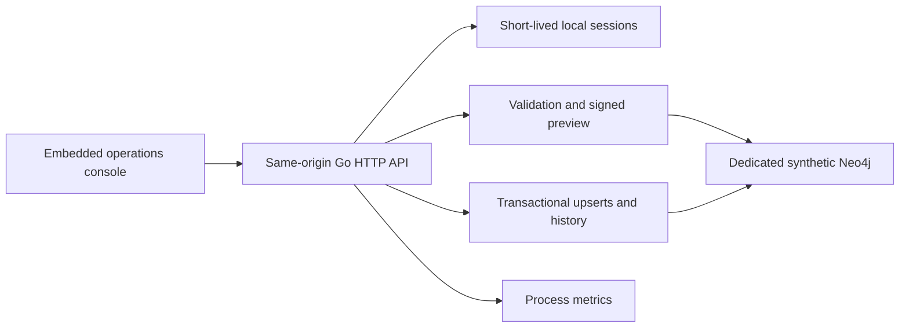
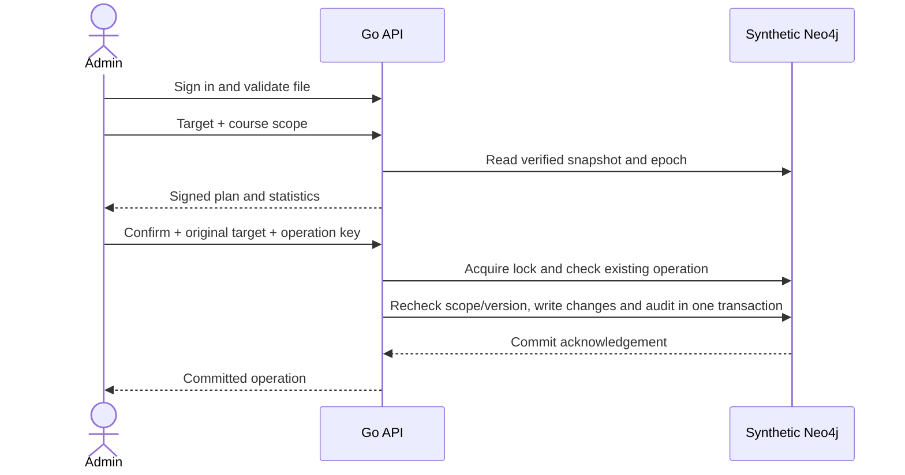
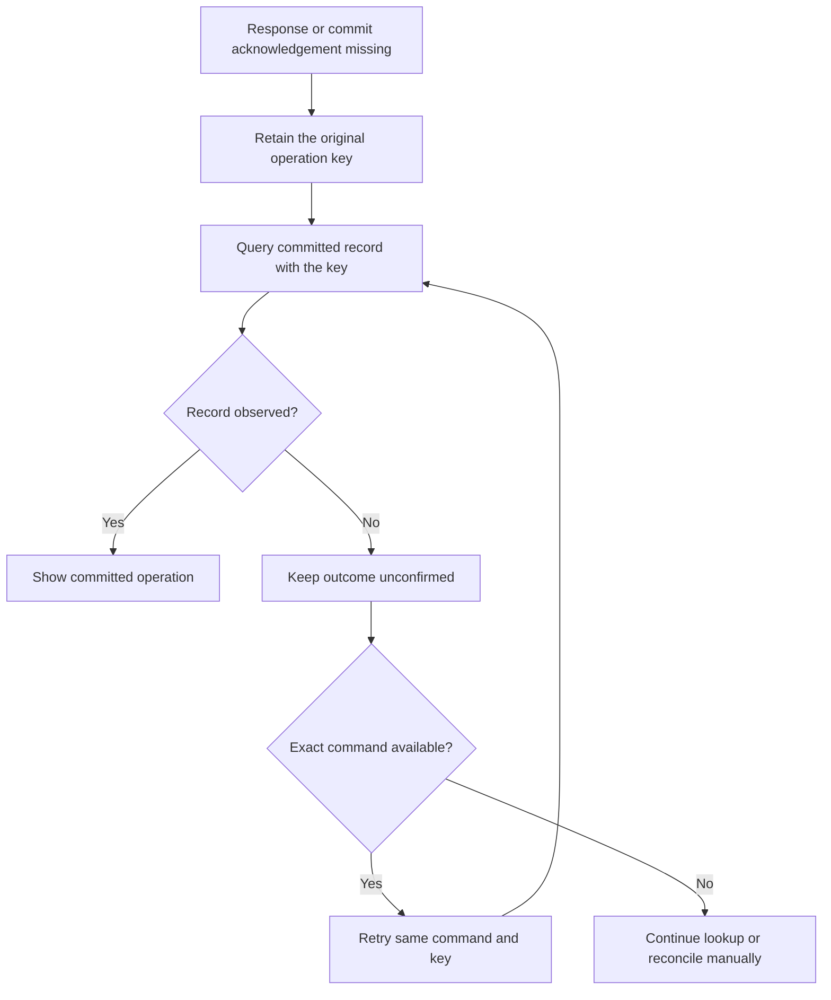

# Graph Operations Console

## 中文操作速览

软件界面名称为「专业教学图谱数据管理与运行监测系统」。以隔离实验库启动 Go 服务后，在浏览器访问本机 `/console`。使用单独设置的管理员访问令牌登录，依次进入「数据导入」「同步预览」「操作历史」和「运行监测」。建议用 `testdata/console.csv` 演示。操作历史只显示 Neo4j 已提交记录，运行统计按本进程累计。发生回执不确定时，在「同步预览」下方以原操作查询键查结果。

## Run the isolated lab

Start a fresh lab and provision its synthetic schema as described in README. Use a loopback Bolt URL with a non-default port, a fresh lab marker, a separate plan key and a distinct administrator token. Each secret is 32 bytes represented as 64 hex characters. Enter the administrator token in the local sign-in form. Keep all credentials in the local process environment or a controlled secret source.

```sh
export GRAPHOPS_ADMIN_TOKEN="$(openssl rand -hex 32)"
export GRAPHOPS_ADMIN_ROLE=operator
go run ./cmd/server -listen 127.0.0.1:8090
```

Open `http://127.0.0.1:8090/console`. By default sessions last 15 minutes and plans last three minutes. A session ends at logout, expiry or process shutdown. Log in again after refresh. The runtime allows `observer` instead of `operator` for a read-only installation. It accepts a short local session TTL via `GRAPHOPS_ADMIN_SESSION_SECONDS` (1 to 3600) and a shorter plan TTL via `GRAPHOPS_LAB_PLAN_SECONDS` (1 to 180) for controlled testing.

## Operator workflow

1. Sign in and confirm the synthetic lab is ready on Overview.
2. Choose Data import and validate `testdata/console.csv`, or use synthetic JSON.
3. Open Sync preview, review the selected course IDs and build a database preview.
4. Review added and modified records, confirm the checkbox and execute.
5. View Operation history for the committed record. Monitoring shows cumulative counts since the Go process started.

The database has no delete action. Invalid files, out-of-range changes, expired plans and conflicts surface in the relevant panel. A definite stale or expired plan needs a fresh preview.

## API and access

| Route | Access and purpose |
|---|---|
| GET /console | Public shell with no graph data |
| GET /health/live, /health/ready | Public coarse process and dependency status |
| POST /api/v1/admin/login | Administrator bootstrap token, JSON field `token` |
| POST /api/v1/admin/logout | Bearer session revocation |
| POST /api/v1/admin/import | Operator, CSV or JSON file validation and parsed data |
| POST /api/v1/graph/db/preview, /db/execute under the graph prefix | Operator. Execute needs original target, signed token, and Idempotency-Key |
| GET /api/v1/graph/db/operation | Operator or observer, same key to confirm a commit |
| GET /api/v1/admin/history | Operator or observer. Optional limit 1 to 50, cursor and status=committed |
| GET /api/v1/admin/operation?id=… | Operator or observer, detail by operation ID |
| GET /api/v1/admin/monitoring and /metrics | Operator or observer when configured |
| POST /api/v1/graph/sync/preview | Existing public offline preview, no database operations |

Send session tokens as `Authorization: Bearer <session>`. Browser session tokens and commands are held in memory. Only the latest operation key and its unresolved flag are retained in tab-scoped sessionStorage. After a refresh, sign in and confirm the operation using that key. Same-command retry is available only when the original command is still available in memory.

## Architecture



## Synchronization



## Confirming an uncertain result



An absent record is not a rollback signal. An expired token with an already committed operation still supports lookup and idempotent replay, but cannot cause a new write. A rejected recomputation or lost browser command should be reconciled before starting a new operation.
